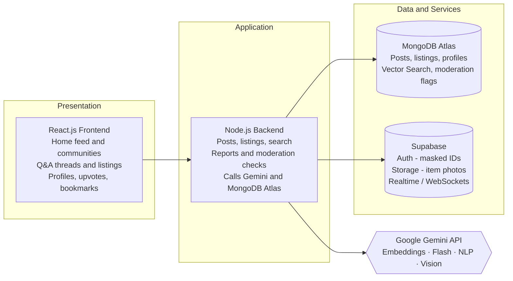

# 🎓 Campusly

### A student-run, Reddit-style web platform built for engineering campus life.

*Juniors and seniors connect to ask, share and exchange.*

**Built for SYRUS 7.0 Hackathon · CodeCell++, CMPN, VESIT** 
**Domain:** Sustainability (PS-4) · **Team:** ByteForce

---

## 📌 Table of Contents

- [Problem Statement](#-problem-statement)
- [Our Solution](#-our-solution)
- [Modules](#-modules)
- [Profiles & Brownie Points](#-profiles--brownie-points)
- [Moderation & Safety](#-moderation--safety)
- [AI-Assisted Features](#-ai-assisted-features)
- [Showstopper: Snap a Photo, Listing Done](#-showstopper-snap-a-photo-listing-done)
- [Architecture & Tech Stack](#-architecture--tech-stack)
- [Implementation Plan](#-implementation-plan)
- [Business Plan](#-business-plan)
- [Sustainability Impact](#-sustainability-impact)
- [Team](#-team)

---

## 🧩 Problem Statement

**CampusConnect: Peer-to-Peer Engineering Learning & Resource Sharing Platform** *(working title: Campusly)*

First-year engineering students feel overwhelmed by academics, tech domains and costly study materials, while seniors' tips and leftover resources sit unused or get lost in WhatsApp groups.

| | Problem | What's happening |
|:---:|---|---|
| ❓ | **No Safe Space to Ask** | Juniors lack a student-run space to ask doubts and get guidance without hesitation. |
| 💬 | **Fragmented Knowledge** | Roadmaps, exam strategies and experiences stay scattered across WhatsApp groups. |
| 📦 | **Idle Resources** | Textbooks and calculators go unused with seniors while juniors buy costly new material. |

**The missing link:** a proper student-run platform where juniors can get guidance, ask openly or anonymously, and easily borrow, buy or exchange study materials.

---

## 💡 Our Solution

**Campusly** is a student-run web platform for engineering students: Reddit-style, but built for campus life. Juniors and seniors connect to ask, share and exchange.

---

## 🧱 Modules

| Module | Name | What it does |
|:---:|---|---|
| **A** | 👥 **Technical Communities** | Hubs for Web3, AI/ML, Cloud and DSA to share roadmaps, project ideas and prep guides. |
| **B** | 💬 **Q&A and Mentorship** | Ask openly or anonymously, get threaded senior advice, and upvote the best answers. |
| **C** | 📣 **Opportunity Hub** | Curated board of hackathons, coding contests and internships with deadlines and tips. |
| **D** | 🔁 **Academic Resource Exchange** | Buy, sell, donate or borrow calculators, textbooks, lab kits and notes. |

---

## 🏆 Profiles & Brownie Points

Every user has a profile with their study year, tech stack and **Brownie** (karma) points, plus bookmarks for useful posts. Users also pick a Bitmoji avatar for their campus profile and comments.

| Action | Brownies |
|---|:---:|
| Create a post | **+15** |
| Your post gets an upvote | **+10** |
| Write a comment | **+5** |
| Your comment gets an upvote | **+5** |

---

## 🛡️ Moderation & Safety

- Flag toxic content, scam listings and identity leaks.
- Anonymous authors stay protected: real IDs are masked at the auth layer.
- Scam or dead links are caught and hidden until a senior approves.
- Past a report threshold, Supabase Realtime pulls the post and alerts moderators.
- Moderators review flagged content from a dedicated view.

---

## 🤖 AI-Assisted Features

Powered by the free **Google Gemini API**:

| Feature | Powered by | Description |
|---|---|---|
| 🔍 **Answers Before You Ask** | Gemini Embeddings + Atlas Vector Search | Semantic search that surfaces matching past threads as you type. |
| 📝 **Threads to Checklists** | Gemini Flash | One click turns a long thread into an actionable checklist or summary. |
| 🚨 **Scam & Toxicity Scans** | Gemini (NLP) | Auto-moderation for scam listings, dead links and toxic content. |
| 📸 **Photo to Listing** | Gemini Vision | Auto-detects title, category and condition from an item photo. |

---

## ✨ Showstopper: Snap a Photo, Listing Done

1. 📷 **Upload a photo:** the item photo goes to free cloud storage (Supabase Storage).
2. 🧠 **Gemini Vision reads it:** auto-detects title, category and condition.
3. 🗄️ **Listing is created:** saved as a MongoDB document, with zero manual typing.

### Other highlights

- 🕵️ **Anonymous, yet protected:** real IDs are masked at the auth layer.
- 🔍 **Answers before you ask:** vector search surfaces past threads as you type.
- ✅ **Threads to checklists:** long threads become actionable checklists.
- 🧹 **Self-cleaning feed:** scam or dead links are hidden until a senior approves.
- 🍫 **Brownie rewards:** points for posts, upvotes and helpful comments.
- ⚡ **Live real-time chats:** learn from seniors through live chats, not just threads.
- 💸 **Built to stay free:** free Gemini API and cloud storage keep AI running without extra infrastructure cost.

---

## 🏗️ Architecture & Tech Stack

| Layer | Technology |
|---|---|
| **Frontend** | HTML, CSS, JavaScript, React.js |
| **UI Styling** | Tailwind CSS |
| **Backend & DB** | Node.js, Supabase, MongoDB (Atlas) |
| **AI** | Google Gemini API (Embeddings, Flash, NLP, Vision) |
| **Dev Tools** | Figma, VS Code, AI coding tools (Claude, Codex, Grok, Gemini) |

---

## 🗺️ Implementation Plan

**Platform flow:** `Sign-up & Profile → Home Feed → Modules A to D → Engagement → Moderation Review → Outcome (SDG 4 & 12)`

| # | Phase | Scope |
|:---:|---|---|
| 1 | **Foundation & Auth** | Supabase Auth with masked identities, profile setup, React + Tailwind shell, Node.js API and MongoDB Atlas data model. |
| 2 | **Knowledge Modules** *(A & B)* | Technical Communities and Q&A & Mentorship: threaded answers, upvotes, Brownie points and bookmarks. |
| 3 | **Opportunities & Exchange** *(C & D)* | Opportunity Hub board and Resource Exchange with Supabase Storage uploads and Gemini Vision auto-listing. |
| 4 | **AI Intelligence Layer** | Embeddings with Atlas Vector Search, Flash thread summaries, and NLP scans for scams, dead links and toxicity. |
| 5 | **Safety & Launch** | Report thresholds, Supabase Realtime takedowns and moderator view; then pilot with first-year students. |

---

## 💼 Business Plan

| Area | Details |
|---|---|
| **👥 Who we serve** | **First-year engineering students:** guidance, answers and affordable materials. **Seniors:** share roadmaps, exam strategies and leftover resources. **Moderators:** review flagged content from a dedicated view. |
| **🎯 Value proposition** | One student-run hub instead of scattered WhatsApp groups. Anonymous or open posting lowers the barrier to ask. Buy, sell, lend or donate materials, with opportunities in one place. |
| **⚡ Lean cost model** | Free Google Gemini API for text, vision and embeddings. Supabase for auth and storage; MongoDB Atlas for data. AI features run without extra infrastructure costs. |

**Growth path (proposed):** Pilot with first-year engineering students on one campus, refine from feedback, then extend to more campuses.

---

## 🌍 Sustainability Impact

- **SDG 4: Quality Education:** peer mentoring and shared roadmaps.
- **SDG 12: Responsible Consumption & Production:** reuse of books, calculators and lab kits over repurchase.
- **Brownie points** reward helpful contributors.

---

## 👨‍💻 Team

**Team ByteForce**

| Name | Role |
|---|---|
| Ayush Singh | Backend & Database |
| Jainil Mutha | Frontend |
| Sandesh Supe | Testing |
| Devang Tayade | PPT & Presentation |

---

Built with ☕ for **SYRUS 7.0 Hackathon** · CodeCell++, CMPN, Vivekanand Education Society's Institute of Technology (VESIT)

